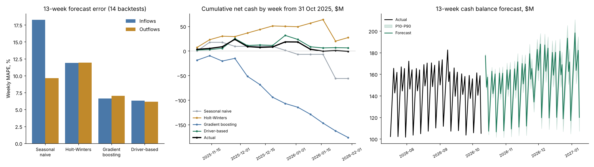

# Treasury Cash Forecasting

Daily and 13-week cash forecasts for a card-payments business, with P10–P90 bands and stress
scenarios. Compares four forecasting methods a treasury team might use (**seasonal naive**,
**Holt-Winters**, **gradient boosting** and a **driver-based** model) in a rolling-origin backtest
over 14 forecast dates.

**[Project page with interactive 13-week forecast and stress levers](https://martinogie.github.io/treasury-cash-forecasting/)**



## Results (14 rolling 13-week backtests, Jul 2025 – Oct 2026)

| Method | Daily MAPE in | Daily MAPE out | Weekly MAPE in | Weekly MAPE out | Week-13 balance error |
|---|---|---|---|---|---|
| Seasonal naive | 22.8% | 30.1% | 18.2% | 9.6% | $187.4M |
| Holt-Winters | 13.4% | 21.8% | 11.9% | 11.9% | $123.0M |
| Gradient boosting | 5.8% | 10.3% | 6.6% | 7.0% | $74.1M |
| **Driver-based** | **5.1%** | **4.0%** | **6.3%** | **6.2%** | **$5.2M** |

Daily MAPE covers the first two weeks of each forecast; weekly MAPE covers all 13 weeks. The
balance error is the mean absolute miss on cumulative net cash at week 13. The driver-based
P10–P90 band held 82.7% of actual balances (target 80%).

What the numbers say:
- **Calendar effects dominate daily cash.** Monday receipts carry the weekend's card volume, and
  holidays push volume onto the next business day. Seasonal naive and Holt-Winters can't see
  either, so their daily errors are 13–30%.
- **Gradient boosting gets each total within about 7%,** but the inflow and outflow errors are
  independent, so cumulative net cash drifts by $74M over 13 weeks.
- **The driver-based model forecasts card volume once** and derives receipts, merchant payouts and
  chargebacks from it using the settlement rules. A volume miss moves both sides together and
  mostly cancels, so the balance error falls to $5M.
- **Holiday float is predictable.** Thanksgiving volume settles on Friday, after that day's weekly
  payout batch has been calculated, so cash builds by about $22M that week and leaves the next.

## Live 13-week forecast

From the close of Friday 9 Oct 2026 (opening balance $105.2M), the lowest forecast balance is
$106.6M (23 Oct) and the lowest P10 is $101.4M (30 Oct). The weekly table is in
[reports/RESULTS.md](reports/RESULTS.md) and [reports/forecast_13_week.csv](reports/forecast_13_week.csv).
On the project page, stress card volume, chargebacks and an unplanned payment against a minimum
cash buffer.

## Design choices

| Choice | Why |
|---|---|
| Rolling-origin backtest from 14 Fridays, history cut at each origin | Scores each method the way it would have run in production, with no look-ahead |
| Forecast the ratio to the trailing level, not the raw amount | Handles 14% annual growth; one model covers every horizon |
| Settlement mapping on a US banking calendar | Weekend and holiday volume lands on the next business day, as it does in a bank account |
| Payroll, vendor runs and taxes from the treasury calendar | These are known in advance; forecasting them statistically only adds error |
| Holt-Winters with a weekday-indexed season | A position-based season slips out of phase after every bank holiday |
| Band = σ·√(days ahead), σ fitted on backtest errors | Simple, explainable, and its coverage is checked against actuals |

## Quick start

```bash
pip install -r requirements.txt
python -m treasury.run                          # generate data, backtest, forecast -> reports/, index.html
python -m unittest discover -s tests            # 9 tests
python -m treasury.forecast --volume-shock -0.15 --out stress.csv
python -m treasury.forecast --volume volume.csv --actuals actuals.csv --plan plan.csv --out fc.csv
```

The full backtest (4 methods × 14 origins) runs in under a minute on a laptop CPU.

## Layout

```
treasury/calendar.py   business days, T+1 settlement mapping, calendar features
treasury/data.py       synthetic card volume and daily cash flows
treasury/models.py     seasonal naive, Holt-Winters, gradient boosting, driver-based
treasury/backtest.py   rolling-origin backtest, MAPE, balance band
treasury/run.py        end-to-end pipeline, chart, reports, project page
treasury/forecast.py   command-line 13-week forecast with a volume shock
web/template.html      project page template (run.py writes index.html)
```

## Data note

All data is synthetic: about 3.8 years of daily card volume with growth, weekday, payday, holiday
and November–December seasonality, plus settlement, payout, payroll, vendor, tax and unplanned
flows. Because the settlement rules are known, every method can be checked against the truth.
In a real treasury these rules come from processor and merchant contracts.

## How this was built

Built with AI-assisted coding (Claude). Modeling choices, validation and review are my own.

## License

MIT
